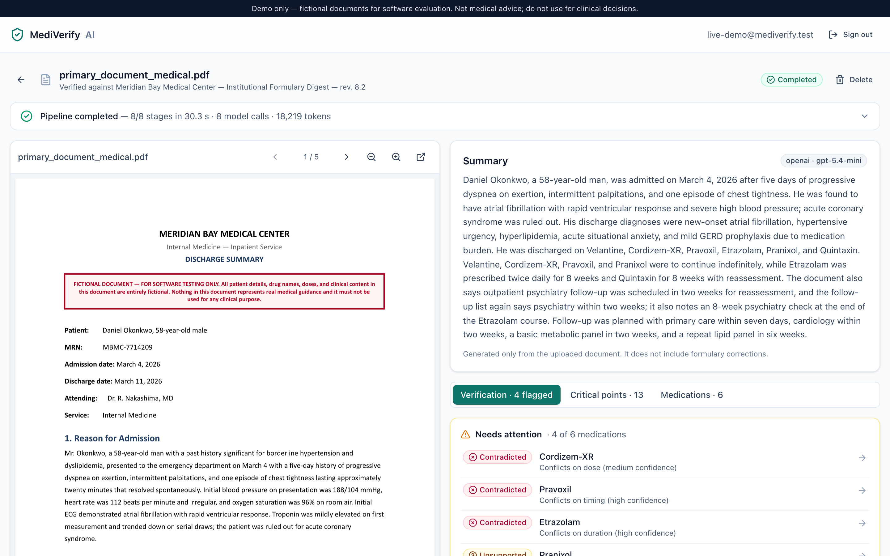
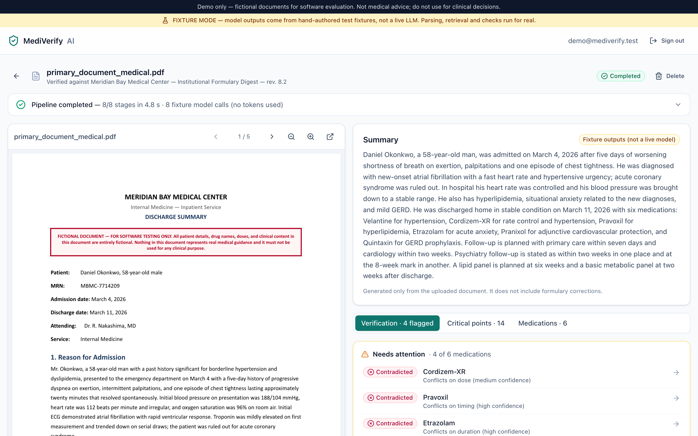
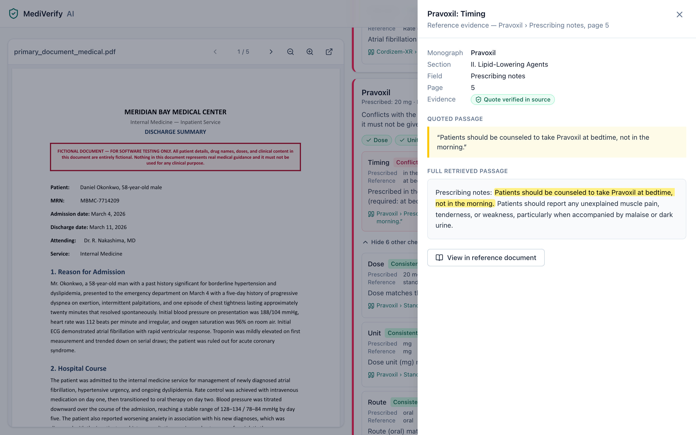
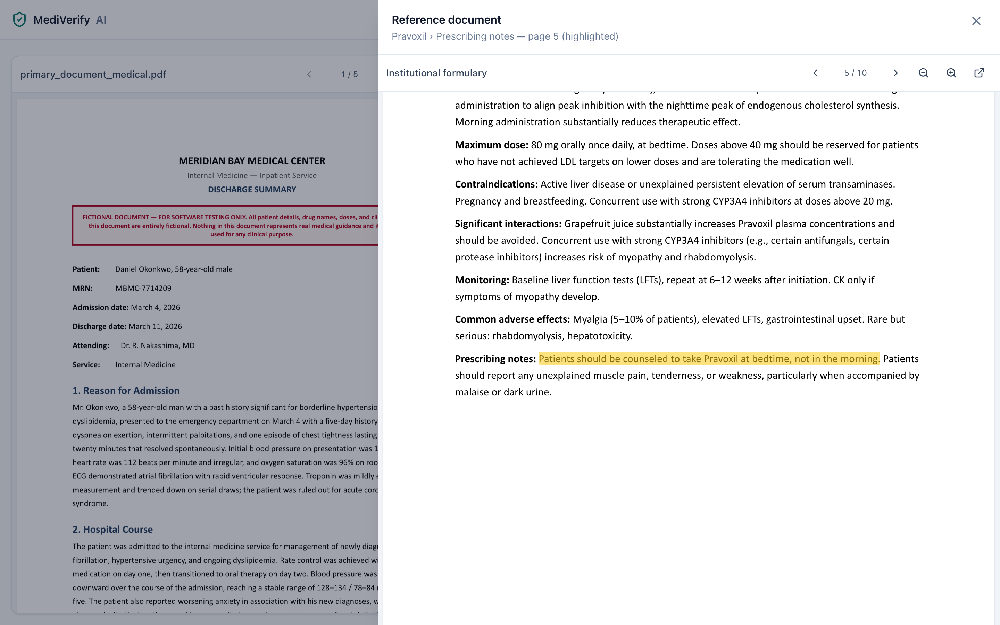
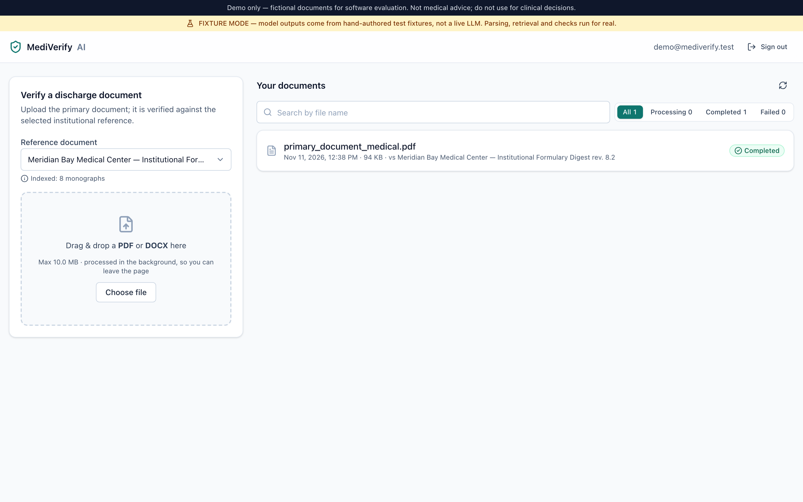
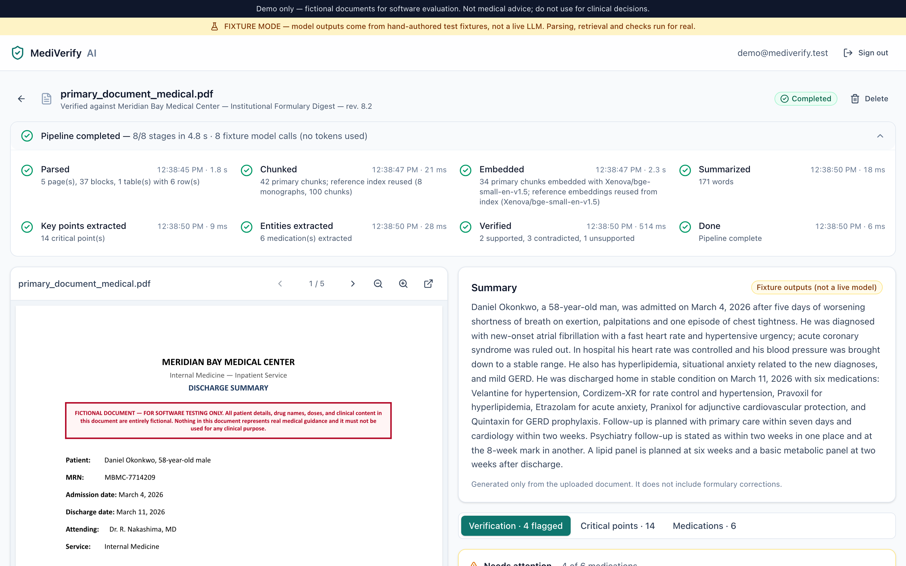
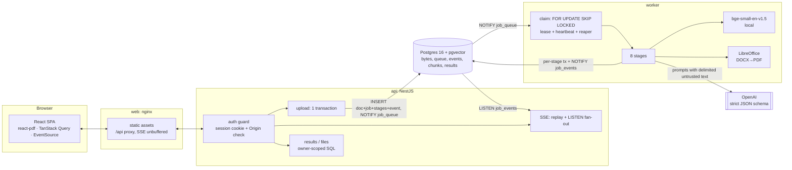
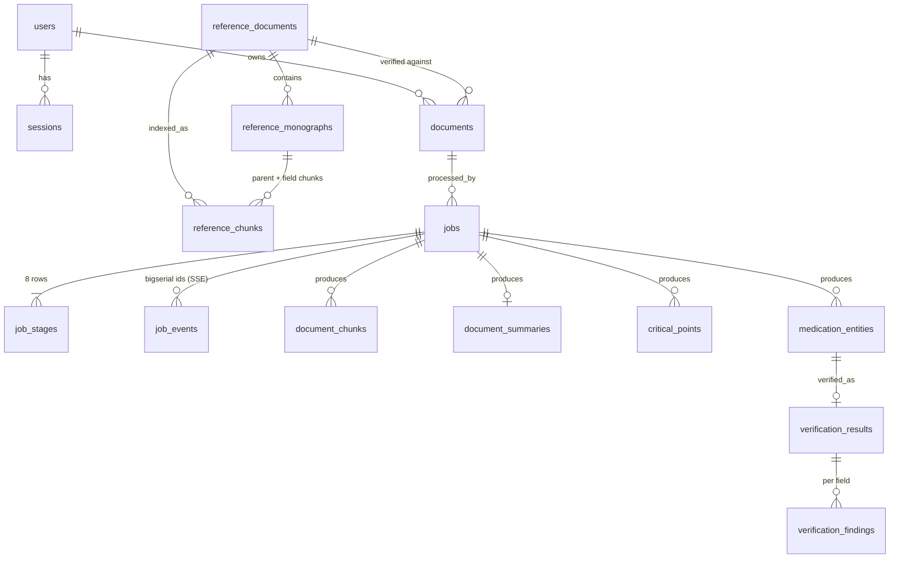

# MediVerify AI

Checks a hospital discharge summary against an institutional formulary digest. It produces:

- a plain-language summary,
- cited critical points,
- a structured medication list,
- and, for each medication, a **Supported / Contradicted / Unsupported** verdict, or **Incomplete** when the
  verification could not be completed (see [Verification statuses](#verification-statuses-three-verdicts-plus-incomplete)).

Every verdict comes with verbatim, validated evidence from the reference.

> **Fictional data, demo only.** The bundled documents are fictional. Nothing here is clinical advice. The UI shows this
> disclaimer at all times.

## Implementation highlights

- **6 / 6 expected medication classifications** on the bundled sample, with the fixture model _and_ with the real
  model (OpenAI `gpt-5.4-mini`): conflict-field precision and recall 100%, every citation validated
  ([evaluation](docs/evaluation.md)).
- **Hybrid RAG with an identity gate.** A drug is matched to a monograph by name or explicit alias only, so a
  look-alike (Pranixol vs Pravoxil) never borrows another drug's rules. Retrieval inside the matched monograph fuses
  vector and full-text rankings (RRF). Every citation quote must appear in the cited chunk.
- **Rules decide, the model explains.** Monograph rules are parsed deterministically at index time. A model claim
  counts only with a validated quote; a scripted adversarial model got 0 fabricated claims accepted.
- **Asynchronous, durable processing.** Uploads return `202` at once. A Postgres queue (`SKIP LOCKED`, leases,
  heartbeats, a reaper) runs 8 tracked stages, streamed live over SSE, with retries and stage timeouts that cancel
  in-flight model calls.
- **Tested where it matters.** 78 unit, 87 web (jsdom + axe) and 58 integration tests against real Postgres:
  authorization (other users' resources → 404), transaction atomicity (an injected failure inside the upload
  transaction leaves nothing behind), crash recovery, the golden pipeline and robustness cases. Plus 6 Playwright E2E
  runs (desktop and mobile, with an accessibility scan). CI runs them on every pull request.
- **Reproducible demo.** `docker compose up --build` runs the whole stack without a key, in a clearly labelled fixture
  mode; add `OPENAI_API_KEY` for real inference.

## Results with the real model

Fixture mode exists so anyone can run the demo without a key and CI stays deterministic: it replays hand-authored
model outputs for the bundled sample only and is labelled in the UI and on every result. The real pipeline has been
run end to end with OpenAI `gpt-5.4-mini` (details and history in [docs/evaluation.md](docs/evaluation.md#live-model-runs-2026-11-10-llm--openai-gpt-54-mini-reasoning-effort-low)):

| Live run                                 | Statuses   | Conflict fields | Citations valid | Critical-point quotes | Usage                            |
| ---------------------------------------- | ---------- | --------------- | --------------- | --------------------- | -------------------------------- |
| Through the app, 2026-11-11 (screenshot) | 6 / 6      | 3 / 3 exact     | 30 / 30         | 14 / 14               | 8 calls · 18,219 tokens · 30.3 s |
| `pnpm eval:live`, 2026-11-11             | 6 / 6      | P / R 100%      | 100%            | 100%                  | 8 calls · 18,318 tokens · 27.6 s |
| 8 × `pnpm eval:live`, 2026-11-10         | 7 / 8 runs |                 | 100% every run  |                       | about US$0.06 per run            |

The one miss in the eight 2026-11-10 runs was an indication false positive, since guarded in code. Both
2026-11-11 runs also kept the document's internal discrepancy (psychiatry follow-up in two weeks vs at 8 weeks)
in the summary and as a cited critical point, with no summary-guard warnings.



## Verification statuses: three verdicts plus Incomplete

The brief's three classifications are unchanged, and they are the only **verdicts**:

| Status           | Meaning                                                                                |
| ---------------- | -------------------------------------------------------------------------------------- |
| **Supported**    | A monograph exists and every prescribing rule it states was checked and is consistent. |
| **Contradicted** | A monograph exists and at least one field conflicts with it (with a validated quote).  |
| **Unsupported**  | The formulary has no monograph for this drug: a coverage gap, not a safety finding.    |
| _Incomplete_     | **Not a verdict.** The verification could not be completed, so no verdict is given.    |

Incomplete is an evidence/processing state, kept separate on purpose: a check that could not finish must never be
shown as "Supported" (a false all-clear) or as "Unsupported" (a false coverage gap). It is used when a value is
missing or ambiguous in the document (a dose range, "5 mL" against a mg rule), when no passage clears the relevance
threshold, when a model claim fails quote validation, or when the model call for that medication fails. The result
says which fields could not be confirmed and why (`not_stated`, `insufficient_evidence`, `unverified`), and the UI
lists it under _Needs attention_. On the bundled sample every verification completes, so all six medications get
one of the three verdicts.

### Screenshots (fixture mode)



| Citation with a verified quote                                                                                                                       | Deep link into the formulary                                                                                        |
| ---------------------------------------------------------------------------------------------------------------------------------------------------- | ------------------------------------------------------------------------------------------------------------------- |
|  |  |

| Document list (search, status filters, upload)                                                                                                | Finished pipeline: 8 stages with timings and details                                                                                           |
| --------------------------------------------------------------------------------------------------------------------------------------------- | ---------------------------------------------------------------------------------------------------------------------------------------------- |
|  |  |

Taken 2026-11-11 with a fresh demo account. [`scripts/dev/screenshots.ts`](scripts/dev/screenshots.ts) recaptures
them from a running stack (`… live` captures the real-model image).

---

## Quick start (≈ 5–10 min, most of it the first image build)

Prerequisites: Docker Desktop (Compose v2+), about 6 GB free disk space, and ports 8088 and 55432 free
(change them with `WEB_PORT` / `DB_HOST_PORT`; the database binds to 127.0.0.1 only).

1. Start the stack. **No `.env` is needed**: without an OpenAI key the app runs in the labelled
   [fixture mode](#llm-modes-real-vs-fixture), which covers the bundled sample document.

```bash
docker compose up --build
```

2. For **real model inference**, put your key in `.env` (`cp .env.example .env`, set `OPENAI_API_KEY=`) and run
   `docker compose up -d` again: with a key the provider switches to OpenAI automatically. Sign-up stays open; spend
   is capped by the per-user and app-wide daily job limits. Every result is labelled with the model that produced it.

3. Open **http://localhost:8088** and sign in:

| User                               | Email                         | Password          |
| ---------------------------------- | ----------------------------- | ----------------- |
| Reviewer                           | `reviewer@mediverify.test`    | `Reviewer#2026`   |
| Second user (for isolation checks) | `second.user@mediverify.test` | `SecondUser#2026` |

4. Upload `resources/primary_document_medical.pdf` against **MBMC Formulary Digest v8.2**. With a real key you can
   also upload the DOCX rendition `fixtures/sample_discharge.docx`. In fixture mode the DOCX fails with
   `FIXTURE_NOT_FOUND`, because fixtures exist only for the PDF's exact bytes.
5. Watch the stages stream in, then open the citations.

Compose starts these services:

| Service   | What it does                                                                                       |
| --------- | -------------------------------------------------------------------------------------------------- |
| `db`      | Postgres 16 + pgvector. Host port 55432.                                                           |
| `migrate` | One-shot: applies versioned migrations, then the idempotent seed (users + reference registration). |
| `api`     | NestJS.                                                                                            |
| `worker`  | Pipeline runner. Includes LibreOffice and the embedding model baked into the image.                |
| `web`     | nginx serving the SPA and proxying `/api`.                                                         |

The worker indexes the reference once at startup and loads the embedding model before it claims jobs.

### Local development (without containers for the apps)

```bash
pnpm install                       # Node 24, pnpm 10
docker compose up -d db            # Postgres only
pnpm db:migrate && pnpm db:seed    # defaults to localhost:55432; set DATABASE_URL in .env to override
pnpm dev:api                       # :3001 (run from the repo root; the script runs it from apps/api)
pnpm dev:worker
pnpm dev:web                       # :5173, proxies /api → :3001
```

**Environment.** Every setting has a default, so nothing _requires_ a `.env`. Compose reads `.env` automatically, and
the host-side commands (`db:migrate`, `db:seed`, `dev:api`, `dev:worker`, `eval`, `eval:live`) load it if it exists.

**Which model runs.** Docker and local development resolve the provider the same way (`resolveLlmProvider` in
`packages/shared`): an empty `LLM_PROVIDER` means OpenAI when a key is present, otherwise fixture mode.

| How you run it                                    | Without `OPENAI_API_KEY`                                     | With `OPENAI_API_KEY`     |
| ------------------------------------------------- | ------------------------------------------------------------ | ------------------------- |
| `docker compose up` (`LLM_PROVIDER` empty)        | fixture mode, labelled in the UI                             | OpenAI (`OPENAI_MODEL`)   |
| `pnpm dev:api` + `pnpm dev:worker` (same rule)    | fixture mode, labelled in the UI                             | OpenAI                    |
| `LLM_PROVIDER=openai` set explicitly              | jobs fail with `MODEL_NOT_CONFIGURED`; the UI shows a banner | OpenAI                    |
| `LLM_PROVIDER=fixture` set explicitly             | fixture mode                                                 | fixture mode (key unused) |
| `pnpm eval` / integration tests / CI / Playwright | fixture mode, always (deterministic)                         | fixture mode, always      |
| `pnpm eval:live`                                  | refuses to start                                             | OpenAI                    |

Fixture mode only has outputs for the bundled sample PDF; any other document fails with `FIXTURE_NOT_FOUND`.

**Getting an OpenAI key:** sign in at platform.openai.com, add API credit under _Settings → Billing_ (separate from a
ChatGPT subscription; consider a monthly usage limit), then _API keys → Create new secret key_. Put it in `.env` as
`OPENAI_API_KEY=` and never commit it (`.env` is git-ignored and the pre-commit secret guard blocks keys).

### Configuration

All settings are environment variables with safe defaults. [.env.example](.env.example) lists every one with
comments, including the queue timings and development settings under "Advanced".

| Setting                                            | Default                   | Purpose                                                                                           |
| -------------------------------------------------- | ------------------------- | ------------------------------------------------------------------------------------------------- |
| `LLM_PROVIDER` / `OPENAI_API_KEY` / `OPENAI_MODEL` | auto / – / `gpt-5.4-mini` | Model provider. Empty = `openai` when a key is set, otherwise `fixture` (the key-less demo)       |
| `LLM_TIMEOUT_MS` / `LLM_MAX_RETRIES`               | `90000` / `3`             | Per-call timeout; retries for 429 rate limits, 5xx and network errors                             |
| `ALLOW_SIGNUP`                                     | `true`                    | Self-service sign-up, in every mode; `false` closes it (seed users still sign in)                 |
| `DAILY_JOB_LIMIT`                                  | `20`                      | Pipeline runs (uploads + retries) per user per rolling 24 h; `0` = unlimited. Duplicates are free |
| `GLOBAL_DAILY_JOB_LIMIT`                           | `200`                     | Pipeline runs across all users per rolling 24 h (spend cap); `0` = unlimited                      |
| `MAX_DOCUMENT_PAGES` / `MAX_DOCUMENT_CHARS`        | `50` / `150000`           | Input limits checked after parsing (`DOCUMENT_TOO_LARGE`); `LLM_MAX_PROMPT_TOKENS` caps prompts   |
| `EVENT_RETENTION_DAYS` / `DOCUMENT_RETENTION_DAYS` | `30` / `0`                | Purge progress events of finished jobs / whole documents (`0` = keep forever)                     |
| `COOKIE_SECURE`                                    | `false`                   | Set `true` behind HTTPS                                                                           |
| `DUPLICATE_WINDOW_SECONDS`                         | `300`                     | Duplicate-upload window; `0` disables                                                             |
| `RETRIEVAL_TOP_K` / `RETRIEVAL_MIN_SCORE`          | `6` / `0.35`              | Passages retrieved per medication and the relevance floor (below it → `incomplete`)               |
| `VERIFY_CONCURRENCY`                               | `3`                       | Medications verified in parallel per job                                                          |
| `WORKER_CONCURRENCY`                               | `1`                       | Jobs per worker container; scale out with `docker compose up --scale worker=N`                    |
| `STAGE_TIMEOUT_MS` / `JOB_MAX_ATTEMPTS`            | `180000` / `3`            | Per-stage limit; attempts before a job is marked failed                                           |

---

## What it does: pipeline

Uploading returns `202 {documentId, jobId, duplicate}` immediately. A separate worker process then runs these stages:

| Stage                  | What happens                                                                                                                                                                                                                            |
| ---------------------- | --------------------------------------------------------------------------------------------------------------------------------------------------------------------------------------------------------------------------------------- |
| `parsed`               | pdf.js text with positions and fonts → lines → headings, labeled paragraphs and **reconstructed tables**. DOCX is converted to PDF with headless LibreOffice first, so both formats share one parser, real page numbers and one viewer. |
| `chunked`              | Primary document → paragraph and table-row chunks. Ensures the reference is indexed; an existing index is reused, and the event says so.                                                                                                |
| `embedded`             | Local `bge-small-en-v1.5` (384-d) embeddings into pgvector.                                                                                                                                                                             |
| `summarized`           | A 120–200-word summary from the primary document only. A faithfulness guard requires every number and proper noun to appear in the source.                                                                                              |
| `key_points_extracted` | Critical points by category. Every point needs a page and a quote that validates against the document. Internal discrepancies, such as the two-week vs 8-week psychiatry follow-up, are kept and cite both quotes.                      |
| `entities_extracted`   | Medications with dose, unit, route, frequency, timing, duration, indication, new-start flag and source page/quote. Values from table cells win over model output. Missing or ambiguous values are `null` plus a flag, never guessed.    |
| `verified`             | Identity gate → targeted retrieval → deterministic checks + LLM verifier → evidence-validated merge (details below).                                                                                                                    |
| `done`                 |                                                                                                                                                                                                                                         |

Each stage records its status (`pending → running → completed | failed | skipped`), timestamps, duration and a
sanitized error. Progress is pushed over SSE and survives a page refresh.

### Expected results on the bundled sample

These are the golden cases from `fixtures/golden.json`, which is used **only in tests**:

| Medication                                 | Status                                     | Why                                                                                                                                                                                                                                                             |
| ------------------------------------------ | ------------------------------------------ | --------------------------------------------------------------------------------------------------------------------------------------------------------------------------------------------------------------------------------------------------------------- |
| Velantine 10 mg PO daily                   | Supported                                  | Matches the standard dose and frequency.                                                                                                                                                                                                                        |
| Cordizem-XR 100 mg PO daily                | **Contradicted: dose** (medium confidence) | A new start (newly diagnosed AF) above the 50 mg standard. The monograph requires +25 mg steps at ≥ 2-week intervals, which can't reach 100 mg by discharge day 7. The confidence is medium because this is an interpretation, and the UI shows the arithmetic. |
| Pravoxil 20 mg every morning               | **Contradicted: timing**                   | The monograph says to take it at bedtime and _not_ in the morning.                                                                                                                                                                                              |
| Etrazolam 0.5 mg BID × 8 weeks             | **Contradicted: duration**                 | Maximum duration is 4 weeks.                                                                                                                                                                                                                                    |
| Pranixol 10 mg                             | **Unsupported**                            | No monograph in this digest. Cites the reference's "Drugs not in this digest" note. It is **never** matched to Pravoxil; it is shown only as "similar name, not matched".                                                                                       |
| Quintaxin 20 mg before breakfast × 8 weeks | Supported                                  | Dose, timing and the 8-week reassessment all match.                                                                                                                                                                                                             |

---

## Architecture



**Why these choices.**

- **Postgres is the only stateful service.** It holds the queue, events, vectors and file bytes. There is no Redis or
  object store to operate, and queue state and results commit in the same transactions.
- **A separate worker process.** A slow model call can never block HTTP, and the API never awaits the pipeline.
- **Raw parameterized SQL (`pg`) instead of an ORM.** Ownership filters and transaction boundaries are visible in the code.

### Repository layout

```
apps/api         NestJS HTTP API + SSE            apps/worker       job runner
apps/web         React 19 + Vite 7 + Tailwind 4   packages/shared   zod DTOs, enums, error codes
packages/db      pool, tx helper, migrator, repos packages/core     parsing, chunking, rules, LLM/embeddings, verification, pipeline
db/migrations    versioned forward-only SQL        fixtures/         golden + robustness cases (tests only), fixture LLM outputs, DOCX sample
tests/           unit, integration, e2e, helpers   docs/             evaluation.md, implementation-plan.md, screenshots
scripts/         migrate, seed, eval (+ lib/robustness), secret guard, bundle-size check
scripts/dev/     developer helpers, run with `pnpm exec tsx --conditions=@mediverify/source scripts/dev/<file>`:
                 make-docx (regenerates fixtures/sample_discharge.docx), screenshots (README images),
                 parse-probe <pdf> (parsed blocks), rules-probe (monograph rules), index-reference (re-index)
```

### Data model



- Results are keyed by `job_id`, so a retry produces a fresh, consistent set.
- Deleting a user cascades to their documents, jobs and results.
- Deleting a reference is `RESTRICT`ed while documents use it.
- Reference monographs store their **deterministically parsed rules** (`rules jsonb`, each with a verbatim quote)
  alongside the chunks.
- At about 100 reference chunks an exact vector scan is fast enough, so there is deliberately no ANN index. Add HNSW
  when the corpus grows.

**Migrations** live in `db/migrations/NNNN_name.sql`. They are forward-only and applied by a small migrator
(`packages/db/src/migrator.ts`) under an advisory lock. Each file is checksummed in `schema_migrations`, so editing an
applied migration fails loudly. The seed (`scripts/seed.ts`) is idempotent.

### Transaction boundaries

| Operation          | Transaction                                                                                                                                                                                                                                                                                                                                                                                                                                                             |
| ------------------ | ----------------------------------------------------------------------------------------------------------------------------------------------------------------------------------------------------------------------------------------------------------------------------------------------------------------------------------------------------------------------------------------------------------------------------------------------------------------------- |
| Upload             | **One** transaction does all of this:<br/>• advisory lock on (owner, sha256)<br/>• duplicate check (same owner + same bytes + same reference within `DUPLICATE_WINDOW_SECONDS`, which returns `200` with the existing job)<br/>• insert the document, including its bytes<br/>• insert the job and its 8 `job_stages` rows<br/>• insert the `job.queued` event<br/>• `NOTIFY`<br/>Any failure rolls back everything; an integration test injects one after the inserts. |
| Claim              | `UPDATE … WHERE id = (SELECT … FOR UPDATE SKIP LOCKED LIMIT 1)`, which sets the lease.                                                                                                                                                                                                                                                                                                                                                                                  |
| Each stage         | A short transaction marks it `running` and writes an event. The **work runs with no transaction open** (model calls can take seconds). A short transaction then deletes and re-inserts the stage's results, marks it `completed`, writes the event and sends `NOTIFY`. Every write transaction first asserts this worker still holds the lease, so a "zombie" worker that lost its lease cannot overwrite results.                                                      |
| Reference indexing | Idempotent per (sha256, embedding model) under an advisory lock. Concurrent jobs wait, then reuse the index.                                                                                                                                                                                                                                                                                                                                                            |

### Failure and retry policy

- **Retryable errors:** network and 5xx errors, rate limits and timeouts. The job is requeued with exponential backoff
  (base 5 s) up to `max_attempts` (3). Completed stages are skipped on resume.
- **Non-retryable errors:** for example `MODEL_NOT_CONFIGURED`, `MODEL_QUOTA_EXCEEDED` (OpenAI 429
  `insufficient_quota`: no credit left, unlike a plain rate limit), `PARSE_FAILED`, `FIXTURE_NOT_FOUND`, refusals and
  schema-invalid output after retries. The stage becomes `failed`, every later stage becomes `skipped`, and the job is
  marked `failed` with a sanitized message. The UI offers **Retry**, which creates a new job.
- **Crashed or hung workers:**
  - A heartbeat extends the lease every 15 s; the lease is 60 s.
  - A reaper requeues expired leases, or fails the job with `WORKER_LOST` once attempts are used up.
  - Each stage has a timeout (180 s).
  - A job can't stay `running` without a live lease.
- **Shutdown:** on SIGTERM the worker finishes the current stage, requeues the job for the remaining stages and stops
  claiming.

### Real-time progress (SSE)

`GET /api/jobs/:id/events` streams events from the persisted `job_events` table:

- **Replay first.** On connect, the API checks ownership, subscribes to the in-process `LISTEN job_events` fan-out
  first, then replays events with `id > Last-Event-ID` (header or `?lastEventId=`), deduplicating by id.
- **Keep-alive.** A heartbeat comment is sent every 15 s.
- **End of job.** A final `event: end` is sent on a terminal status.
- **Client side.** The client loads the snapshot (`GET /api/jobs/:id`, which includes `lastEventId`), then opens
  `EventSource` from that id. A refresh or a dropped connection loses nothing and duplicates nothing. The timeline
  shows a "reconnecting" state.
- **nginx.** It turns proxy buffering off for this route.

---

## RAG and verification design

### Chunking

- **Monograph-aware reference chunking.** A monograph starts at a heading line followed by `Drug class:`. Each
  monograph gets:
  - one **parent chunk** (identity + all fields), and
  - one **field chunk** per label (Indication, Standard adult dose, Maximum dose, Contraindications, Interactions,
    Monitoring, Adverse effects, Prescribing notes), all sharing `monograph_id`.

  Preface, quick-reference summary and the "Drugs not in this digest" coverage note are separate chunk kinds and can
  never be treated as a monograph. Embedding text is prefixed with the drug name, so field chunks keep their identity.

- **Primary document.** Paragraph chunks, plus one chunk per table row with structured cells. A row is never split.

- **Why this chunking.** Verification asks field-level questions ("what is the maximum dose?") about one drug, so the
  unit of retrieval is a monograph field, tied to its monograph by id — fixed-size windows would mix fields and drugs
  and make citations vague. The parent chunk keeps whole-monograph context for the model; the drug-name prefix stops
  "Maximum dose: 40 mg" chunks of different drugs from embedding identically; a table row is one prescription, so
  splitting it would break the evidence.
- **Why `bge-small-en-v1.5` (384-d, local).** No document text leaves the machine for embeddings, there is no per-call
  cost or key, it is deterministic for tests, and it is small enough to bake into the worker image. Within a matched
  monograph it already reaches Recall@6 = 1.00 on the evidence fields; a larger model would only matter for
  whole-corpus search, which identity gating makes unnecessary here.

### Verification, per medication

1. **Identity gate (lexical).** The drug name must match a monograph exactly after normalization ("Cordizem XR" =
   "Cordizem-XR"), or through an explicit alias.
   - Vector or fuzzy similarity **never** establishes identity. `pnpm eval` shows why: plain similarity search ranks a
     look-alike first for _every_ absent name tested (Pranixol → Pravoxil at cosine 0.818, overlapping the true
     matches at 0.86–0.89).
   - No match → **Unsupported**, citing the coverage note. Close names are listed as "similar, not matched".
2. **Targeted retrieval** inside the matched monograph only: one query per prescribing aspect (dose, schedule,
   duration, indication/contraindications), each ranked by embedding similarity and by full-text rank, fused with
   **Reciprocal Rank Fusion** (top-K = 6). After ranking, the Contraindications field is always appended and every
   field a deterministic rule cites is added (`evidencePassages`), so a ranking miss can't hide a constraint. These
   additions are not counted in the retrieval Recall@K below. Relevance gate: best cosine ≥ 0.35.
   Retrieval failure → `incomplete`, never "unsupported". (The earlier `0.7·cosine + 0.3·ts_rank` mix was replaced:
   measured, its full-text half matched no chunk with AND semantics and saturated otherwise — see the ablation in
   [docs/evaluation.md](docs/evaluation.md).)
3. **Deterministic checks.** Rules are parsed from the monograph text at index time, each with its verbatim quote:
   unit, dose vs standard/reduced/max (single and daily), titration (increment and minimum interval), route,
   frequency, required/forbidden timing, max duration and reassessment.
4. **LLM verifier** (strict JSON schema). It sees only the extracted prescription and the retrieved passages, each in a
   delimited block marked as untrusted data. For each field it returns a verdict
   (`consistent | conflict | not_addressed`), the constraint, an explanation, a `passage_id` and a quote.
5. **Merge and evidence validation.**
   - Every quote must appear (whitespace/quote-normalized) in a chunk that belongs to the **matched** monograph. A
     mislabelled passage id is re-anchored to the chunk that actually contains the quote.
   - A deterministic conflict with a validated quote is authoritative.
   - An LLM-only conflict counts only if its quote validates. Otherwise it is dropped and recorded as invalid evidence.
   - An LLM-only **indication** conflict also needs the restriction to apply to this patient: the excluded condition
     ("children under 12", "pregnancy") must be documented in the discharge document. Otherwise the field is
     "insufficient evidence", not a conflict, and not "safe".
   - Quotes that decide a verdict must be substantive (≥ 3 words); "once" or "10 mg" never validates a claim.
   - Disagreements are kept, along with `decided_by`.
6. **Status.** Every field carries a reason when it isn't decisive: `not_constrained` (the monograph sets no rule),
   `not_stated` (the prescription doesn't say), `insufficient_evidence`, `unverified` (model claim rejected).
   - **Contradicted:** any field conflicts.
   - **Supported:** dose confirmed consistent, route and frequency consistent (or unconstrained), and every other field
     consistent or unconstrained.
   - **Incomplete:** anything else — the summary lists which fields could not be confirmed and why.
   - **Unsupported:** no monograph in this reference (a coverage gap, not "unsafe").

   **Why Incomplete is kept apart from the three verdicts** (see
   [Verification statuses](#verification-statuses-three-verdicts-plus-incomplete)). A reviewer must never read "we
   couldn't check" as "fine". Unsupported is a property of the reference (it has no monograph), Incomplete is a
   property of the evidence (parse, retrieval, model or data gap), and only Supported asserts that every rule the
   formulary states was checked. The label comes from these
   deterministic rules over validated findings, never directly from the model. One failed model call makes only that
   medication Incomplete; the rest are still verified.

### Critical points ranking

Points are ordered by a fixed category weight, then by severity:

1. Serious side effect to report
2. Administration timing
3. Duration limit
4. Follow-up / lab
5. General safety
6. Document discrepancy

This puts what a patient or reviewer must act on first. The weights are explicit in
`packages/core/src/tasks/critical-points.ts` and are not left to the model's ordering. Formulary corrections never
rewrite primary-document points. They appear only in verification results, which link to the point about the same drug.

### Hallucination and prompt-injection controls

- **Untrusted inputs.** Documents and retrieved passages are wrapped in delimited blocks; a closing tag inside a
  document is neutralized. The system prompt forbids following instructions found inside them.
- **Constrained output.** All model output is constrained by strict JSON Schema (generated from zod) and re-validated.
- **Citations.** Every citation and critical point is quote-validated. Anything that fails is dropped or marked, never
  shown as verified.
- **Summary guard** (deterministic): numbers and capitalized terms must exist in the source; a dose next to a drug
  name must be paired with that drug in one source sentence or table row; a negation added or dropped against every
  closely matching source sentence is flagged. Failures get one retry, then the summary is stored with visible
  warnings. Measured: 0 false warnings on the fixture summary and 8 live-model summaries.

### Retrieval evaluation strategy

Retrieval is evaluated as four separate questions, because each one fails in a different way. `pnpm eval` measures
all four against the bundled documents and writes a JSON report (CI keeps it as an artifact). Full tables and
failure modes are in [docs/evaluation.md](docs/evaluation.md).

| Question                                 | How it is measured                                                                                                                                                                                                  | Result (fixture LLM, real retrieval)                                                                                                                                                              |
| ---------------------------------------- | ------------------------------------------------------------------------------------------------------------------------------------------------------------------------------------------------------------------- | ------------------------------------------------------------------------------------------------------------------------------------------------------------------------------------------------- |
| **Is the right monograph chosen?**       | Identity gate on 5 positives (the prescribed drugs that have monographs) and 7 negatives: Pranixol plus adversarial look-alikes (Velantina, Quintaxol, Etrazepam, Floranex, Sumavastin, "Cordizem" without "-XR")   | 5/5 matched, 7/7 correctly not matched                                                                                                                                                            |
| **Would vector search alone be safe?**   | Diagnostic: the same names queried against _all_ chunks without the gate                                                                                                                                            | Every absent name retrieves a look-alike (e.g. Pranixol → Pravoxil, cosine 0.818, overlapping true matches at 0.86–0.89). No threshold separates them, which is why identity is decided lexically |
| **Are the deciding passages retrieved?** | Recall@K of the expected evidence fields (from the golden file) in the **ranking alone**, inside the matched monograph, for vector-only, the old weighted hybrid and RRF. Chunks added after ranking are excluded   | RRF: Recall@3 **0.93**, **Recall@6 1.00** (weighted hybrid 0.83 / 1.00; vector-only 0.93 / 1.00), so K defaults to 6                                                                              |
| **What does the verifier actually get?** | Final evidence coverage: expected fields present in the passages handed to the verifier (relevance gate + always-appended Contraindications + rule-cited fields), via the same `evidencePassages` the pipeline uses | **1.00**; the post-ranking additions contributed no expected field (only Cordizem-XR's Contraindications was appended), so the Recall@6 above is not inflated by them                             |

End to end, the same run checks verdict accuracy (6/6), conflict-field precision and recall (100%/100%), that every
citation's quote validates in its chunk (100%), and that distractor monographs never appear in findings (0).
A robustness section goes beyond the one sample:

- 14 prescription perturbations (units, separators, ranges, PRN, look-alikes, unstated meal relation and so on), all classified as expected.
- A scripted adversarial model that confirms or flags everything with fabricated quotes. 0 of its fabricated claims were accepted, and all three real contradictions were kept.
- An injected extraction of a drug that isn't in the document. It was dropped.

See [docs/evaluation.md](docs/evaluation.md#5-robustness-beyond-the-one-sample-2026-11-11).
`pnpm eval:live` repeats the run with real OpenAI inference (`gpt-5.4-mini`). The final live run scored the same as
the fixture run, and also kept the document's internal follow-up discrepancy. The 8 live runs exposed three
problems the fixtures could not show, all fixed: a lost discrepancy, a table-quote validation bug, and an indication
false positive. Details are in [docs/evaluation.md](docs/evaluation.md#live-model-runs-2026-11-10-llm--openai-gpt-54-mini-reasoning-effort-low).

### Tracing one document through the logs

Worker and API write pino JSON. Every pipeline line carries `job_id`, `document_id`, `stage`, `event` and
`duration_ms`, so one document can be followed end to end:

```bash
docker compose logs worker api | grep <job_id>
```

| Stage                    | Events to look for                                                                                                                                                                                                                                                                                                                    |
| ------------------------ | ------------------------------------------------------------------------------------------------------------------------------------------------------------------------------------------------------------------------------------------------------------------------------------------------------------------------------------- |
| Ingestion                | `upload.accepted` / `upload.duplicate` (API: document and job ids, size, type), `job.started`, `stage.started` / `stage.completed` with `duration_ms` and a detail line (pages, blocks, table rows, chunks, index reuse)                                                                                                              |
| Extraction               | `llm.call` (task, model, latency, token usage) and `llm.error` (code, retryable, attempt)                                                                                                                                                                                                                                             |
| Retrieval + verification | `verification.result` per medication: identity-gate outcome (`exact` / `alias` / `none`), matched monograph, rejected look-alike names, top passages (chunk id, field, score), passages dropped below the relevance threshold, conflicting fields, which side decided each finding (deterministic rules or the model), invalid quotes |
| Failure                  | `stage.retrying` (transient error, job requeued; includes the attempt) or `stage.failed` (with `error_code`; later stages skipped, job failed), plus `job.lease_lost` / `reaper.recovered` for worker crashes                                                                                                                         |

Logs never contain passwords, tokens, API keys, document text or quotes; only ids, counts, scores and lengths.

### Models

| Purpose    | Model                                                                                                               | Why                                                                                                                  |
| ---------- | ------------------------------------------------------------------------------------------------------------------- | -------------------------------------------------------------------------------------------------------------------- |
| LLM        | OpenAI, default `gpt-5.4-mini` (`OPENAI_MODEL`), Chat Completions with `response_format: json_schema, strict: true` | Schema-guaranteed output, low cost and latency for extraction. The provider sits behind the `LlmProvider` interface. |
| Embeddings | `Xenova/bge-small-en-v1.5` (384-d, quantized, local via transformers.js, baked into the worker image)               | No key, no data leaves the box, deterministic. Strong retrieval for its size.                                        |

### LLM modes: real vs fixture

| `LLM_PROVIDER` | Behaviour                                                                                                                                                                                                                                                                                                                                                                                                                                                  |
| -------------- | ---------------------------------------------------------------------------------------------------------------------------------------------------------------------------------------------------------------------------------------------------------------------------------------------------------------------------------------------------------------------------------------------------------------------------------------------------------- |
| `openai`       | Real inference (the default whenever `OPENAI_API_KEY` is set). Set explicitly without a key, jobs fail clearly with `MODEL_NOT_CONFIGURED` and the UI shows a banner.                                                                                                                                                                                                                                                                                      |
| `fixture`      | The default without a key. **Hand-authored** model outputs for the bundled sample only (keyed by the document's sha256). They live in `fixtures/llm/`. Everything else runs for real: parsing, table reconciliation, embeddings, retrieval, deterministic checks, merge and quote validation. Unknown documents fail with `FIXTURE_NOT_FOUND`; nothing is fabricated. The UI shows a **FIXTURE MODE** banner. Used for CI, the E2E test and offline demos. |

---

## API

All routes are under `/api`. Errors use the shape `{ "error": { "code", "message", "details?" } }`.

| Method | Path                              | Notes                                                                                                                                                                           |
| ------ | --------------------------------- | ------------------------------------------------------------------------------------------------------------------------------------------------------------------------------- |
| POST   | `/auth/signup`                    | 201. Password ≥ 8 characters. Rate-limited.                                                                                                                                     |
| POST   | `/auth/login`                     | 200. Sets the `mv_session` cookie (HttpOnly, SameSite=Strict). Rate-limited. Timing equalized for unknown emails.                                                               |
| POST   | `/auth/logout`                    | 204                                                                                                                                                                             |
| GET    | `/auth/me`                        | Session probe: 200 `{user}`, or `{user: null}` when signed out (no 401, so a signed-out visit logs no failed request).                                                          |
| GET    | `/references`                     | Shared and read-only.                                                                                                                                                           |
| GET    | `/references/:id/file`            | The reference PDF (for the deep link).                                                                                                                                          |
| GET    | `/references/:id/chunks/:chunkId` | Citation preview.                                                                                                                                                               |
| POST   | `/documents`                      | multipart `file` + `referenceId`. Returns **202** `{documentId, jobId, duplicate:false}`, or **200** with `duplicate:true`.                                                     |
| GET    | `/documents`                      | Paged and filtered on the server: `?limit=25&cursor=&status=all\|processing\|completed\|failed&q=`. Returns `{items, nextCursor, counts}`; keyset cursor on `(created_at, id)`. |
| DELETE | `/documents/:id`                  | 204. Deletes the document with its jobs, events and results.                                                                                                                    |
| GET    | `/documents/:id`                  |                                                                                                                                                                                 |
| GET    | `/documents/:id/file`             | Inline PDF (the converted PDF for DOCX). `?download=1` returns the original.                                                                                                    |
| GET    | `/jobs/:id`                       | Snapshot: stages, timings, errors, `lastEventId`.                                                                                                                               |
| GET    | `/jobs/:id/events`                | SSE (see above).                                                                                                                                                                |
| GET    | `/jobs/:id/results`               | Summary, critical points, medications, verifications with citations.                                                                                                            |
| POST   | `/jobs/:id/retry`                 | 202. Only for the document's latest job, when it failed (concurrent retries can't start two pipelines).                                                                         |
| GET    | `/health`, `/config`              | Liveness; LLM mode for the UI banner.                                                                                                                                           |

**API error codes:**

| Code                     | Meaning                                         |
| ------------------------ | ----------------------------------------------- |
| `VALIDATION_FAILED`      | 400                                             |
| `UNAUTHENTICATED`        | 401                                             |
| `FORBIDDEN_ORIGIN`       | 403 (CSRF)                                      |
| `INVALID_CREDENTIALS`    | 401                                             |
| `EMAIL_TAKEN`            | 409                                             |
| `NOT_FOUND`              | 404, including _other users' resources_         |
| `UNSUPPORTED_MEDIA_TYPE` | 415                                             |
| `PAYLOAD_TOO_LARGE`      | 413 (over 10 MB, or a DOCX over 50 MB unpacked) |
| `REFERENCE_NOT_FOUND`    | 404                                             |
| `JOB_NOT_RETRYABLE`      | 409                                             |
| `RATE_LIMITED`           | 429                                             |
| `QUOTA_EXCEEDED`         | 429 (per-user or app-wide daily budget)         |
| `SIGNUP_DISABLED`        | 403                                             |
| `INTERNAL`               | 500 (sanitized)                                 |

**Pipeline error codes** (shown on stages and jobs):

- Parsing and indexing: `PARSE_FAILED`, `UNSUPPORTED_DOCUMENT`, `CONVERSION_FAILED`, `REFERENCE_INDEX_FAILED`,
  `EMBEDDING_FAILED`.
- Model: `MODEL_UNAVAILABLE`, `MODEL_NOT_CONFIGURED`, `MODEL_QUOTA_EXCEEDED`, `MODEL_REFUSED`, `MODEL_OUTPUT_INVALID`,
  `MODEL_OUTPUT_TRUNCATED`, `FIXTURE_NOT_FOUND`.
- Runtime: `STAGE_TIMEOUT` (the stage's model calls and LibreOffice are aborted, not left running), `DOCUMENT_TOO_LARGE`
  (over `MAX_DOCUMENT_PAGES` / `MAX_DOCUMENT_CHARS`, or a prompt over `LLM_MAX_PROMPT_TOKENS`), `WORKER_LOST`, `INTERNAL`.

---

## Security and privacy

- **Authorization.** Every user-owned query includes `owner_id = $user` in SQL: documents, file download, jobs, SSE,
  results and retry. Another user's resource returns **404**, not 403. Integration tests check each route, including
  SSE, as a second user. References are shared read-only.
- **Sessions.**
  - Passwords are hashed with argon2id.
  - The session token is 32 random bytes; only its sha256 is stored.
  - Cookie: HttpOnly, SameSite=Strict; `Secure` is configurable for TLS deployments.
  - Mutating requests must carry an allowed `Origin`.
  - Web and API share an origin through the nginx/Vite proxy, so there is no CORS.
- **Spending and abuse limits.** Sign-up is open in every mode (an operator can close it with `ALLOW_SIGNUP=false`);
  each user gets a rolling 24 h budget of pipeline runs (`DAILY_JOB_LIMIT`) and the whole deployment another
  (`GLOBAL_DAILY_JOB_LIMIT`), both checked inside the job-creating transaction under advisory locks. Input limits
  (`MAX_DOCUMENT_PAGES`, `MAX_DOCUMENT_CHARS`, `LLM_MAX_PROMPT_TOKENS`) stop oversized documents before any model
  call, and each job records its model calls and tokens (cost too, when `LLM_PRICE_*` is set). Login/sign-up are
  rate-limited per client IP (`TRUST_PROXY` makes the API see the address nginx forwards).
- **Deployment defaults.** The database port binds to 127.0.0.1 only; its password comes from `POSTGRES_PASSWORD`;
  the API warns at startup when `COOKIE_SECURE` is off in production.
- **Uploads.** Checked server-side for extension, magic bytes (`%PDF-`, or a DOCX zip containing `word/document.xml`)
  and size. A DOCX whose zip directory declares more than 50 MB unpacked (a zip bomb) is refused with 413, and the
  worker checks again before conversion. Files are stored as `bytea` and never written to a public path. DOCX
  conversion runs LibreOffice with an isolated, throwaway profile and a timeout.
- **No published source.** Production web images ship no source maps; the PDF viewer (react-pdf + pdf.js) is a
  separate chunk loaded only when a document opens.
- **Dependencies.** CI fails on high/critical advisories in production dependencies (`pnpm audit --prod`).
- **Headers.** nginx sets CSP, `X-Frame-Options: DENY`, `X-Content-Type-Options` and `Referrer-Policy` on every
  response, static assets included; the API also sets the last two.
- **Data lifecycle.** Users can delete a document (everything cascades). The worker's maintenance task purges expired
  sessions and the progress events of finished jobs after `EVENT_RETENTION_DAYS` (30), and — if
  `DOCUMENT_RETENTION_DAYS` is set — whole documents. Citations keep a snapshot of their passage, so they survive a
  reference re-index.
- **Secrets** come only from the environment. `.env` is git-ignored. A pre-commit secret guard and gitleaks run in CI.
  The API key never reaches the browser bundle.
- **Logs** are pino JSON with `job_id`, `document_id`, `stage`, `event` and `duration_ms`. They **never** contain
  passwords, tokens, cookies, API keys, raw document text or patient quotes; only lengths, hashes and ids.

---

## Testing and quality

```bash
pnpm test:unit          # 78 tests: parsing/table reconstruction (PDF + LibreOffice-rendered DOCX), monograph chunking & rules,
                        #           identity gate, quote validation, deterministic checks, merge controls, strict schemas,
                        #           injection, error classification, bounded concurrency, dependency pins, status
                        #           rules, parsers (doses/units/frequencies/timing), RRF retrieval, summary guard, DOCX zip-bomb guard
pnpm test:web           # 87 React tests in jsdom (Testing Library + MSW + axe-core): pages, results, upload, auth, SSE
pnpm test:integration   # 58 tests vs real Postgres (incl. robustness: perturbations, adversarial model) (needs `docker compose up -d db`; creates `mediverify_test`)
pnpm test:coverage      # all three, with v8 coverage and thresholds (CI publishes the summary and HTML report)
pnpm test:e2e           # Playwright (desktop + Pixel 7) vs the running Compose stack in fixture mode:
                        #   reviewer flow + axe WCAG 2.1 AA scan of every page (incl. colour contrast)
pnpm size               # build the web app and enforce gzip bundle budgets
pnpm eval               # retrieval + classification + robustness evaluation → numbers in docs/evaluation.md
pnpm eval:live          # same with real OpenAI (needs OPENAI_API_KEY)
pnpm run ci             # format:check + lint + typecheck + unit + web + integration (mirrors GitHub Actions)
                        # (`pnpm ci` without `run` is a built-in pnpm command, not this script)
```

The integration tests break down as follows:

- **Golden pipeline (21):** all 6 statuses, the conflicting field, the matched monograph and page, citation integrity,
  no distractor findings, and discrepancy preservation. DOCX parity (identical table cells from the
  LibreOffice-converted DOCX) is covered by the unit tests.
- **API (16):** auth, cookie flags and argon2, CSRF, 401s on every route, 202 atomic upload, validation, **transaction
  rollback** via an injected fault, duplicates, **IDOR across every route including SSE and delete**, SSE replay,
  resume and live streaming, keyset pagination with server filters and counts, delete cascade, and racing retries.
- **Worker reliability (12):** non-retryable failure, retry then fail, idempotent resume, `SKIP LOCKED` exclusivity,
  reaper, zombie-lease protection, surviving a dropped LISTEN connection, **stage timeout aborting the in-flight model
  call**, the page limit refusing a document before any model call, one medication's failure isolated (with usage
  recorded), citation snapshots surviving a re-index, and retention.
- **Deployment limits (4):** sign-up disabled, per-user and app-wide daily run budgets, sign-up still open with a
  paid key.

The **web tests** (`apps/web/test`) render real components with the app's providers. The API is mocked with MSW,
using responses captured from a fixture-mode run of the bundled sample, so the DTO shapes match the server exactly. They cover:

- upload validation and drag-and-drop
- the document list's search, filters, empty, error and retry states, and optimistic upload with rollback
- results grouping, status filters, citation sheet, critical-point → verification jump with focus, and medications table
- failed-job messages and retry; live SSE progress with replay de-duplication
- sign-in and sign-up forms: client-side validation with inline field errors (email, password length, confirmation),
  server errors mapped to fields, the password show/hide toggle keeping focus, no error carried between the two
  screens; disabled sign-up; route protection; the per-route error boundary
- the pipeline accordion (collapsed when completed, open on the failed stage), back-to-top, and a cleared zero-match
  search keeping focus without flashing the empty state

Each page also runs an axe-core check. Colour contrast needs real layout, so it is checked in Playwright instead
(`tests/e2e/a11y.spec.ts`).

Coverage (unit + web + integration, 2026-11-11): 86.8% statements, 83.6% branches, 89.4% functions. It was 57.6%
before the component tests; the thresholds in `vitest.config.ts` were raised to match.

**Tooling.**

- TypeScript strict (`noUncheckedIndexedAccess`, `exactOptionalPropertyTypes`).
- ESLint flat config, type-aware, with `no-floating-promises`, import order, react-hooks, jsx-a11y and
  testing-library (component tests query by role and label, not DOM structure).
- Prettier.
- Husky hooks:
  - `pre-commit`: lint-staged + secret guard.
  - `commit-msg`: commitlint (Conventional Commits).
  - `pre-push`: typecheck + unit + web tests.

  `pnpm install` installs the hooks through `prepare`, but only inside a git repository. If you ran `pnpm install`
  before `git init` (or hooks don't fire), run `pnpm exec husky` once. `git config core.hooksPath` should then print
  `.husky/_`.

**CI/CD** (`.github/workflows/`):

- `ci.yml` runs these jobs:
  - quality, including the web bundle-size budget
  - test (unit, web, integration with coverage), with a pgvector service and the eval report as an artifact
  - compose build + Playwright E2E and accessibility scan
  - security (`pnpm audit` + gitleaks)
  - a manual `eval-live` job gated on the `OPENAI_API_KEY` secret
- `release.yml` builds images on `v*` tags and pushes to GHCR only when the `PUBLISH_IMAGES` variable is enabled.
- Dependabot is configured for npm, Actions and Docker.

> **Status (2026-11-11):** GitHub Actions passes on `main` (after PR #20). That covers format, lint, typecheck and
> bundle budget; unit, web and integration tests with coverage thresholds; the dependency audit and secret scan; and
> the Compose build with Playwright E2E (smoke + accessibility, desktop + Pixel 7, fixture mode). Locally: 78 unit,
> 87 web, 58 integration and 6 Playwright tests pass. That count includes the robustness evaluation, partial results
> and the DOCX zip-bomb guard, which are newer than the last `main` CI run. The live OpenAI evaluation ran locally
> (`pnpm eval:live`; last run 2026-11-11, after the hardening sprint). The manual `eval-live` CI job needs an
> `OPENAI_API_KEY` repository secret and has not run in CI.

Measured evaluation results, method and failure modes are in **[docs/evaluation.md](docs/evaluation.md)**.

---

## Extra credit

- ✅ **Deep-link citations.** "View in reference document" opens the formulary PDF at the cited page with the exact
  quote highlighted.
- ✅ **Duplicate upload detection.** Same owner + same bytes (sha256 content hash) + same reference within the window
  returns the existing job. The window is `DUPLICATE_WINDOW_SECONDS` (default 300 = 5 minutes; 0 disables it). The
  check runs inside the upload transaction under an advisory lock on (owner, hash), so two simultaneous uploads can't
  both create jobs.

## Trade-offs and known limitations

- **Small labelled evaluation set.** End-to-end and live numbers come from one document (8 full live runs plus
  targeted runs). Model output varies between runs; one run in eight produced an indication false positive, which is
  now guarded in code. The robustness evaluation adds 14 prescription variants, an adversarial model and an injected
  extraction. These test the checks, not extraction from other layouts. More labelled documents are the next step.
- **Cordizem-XR is interpretive.** The titration rule is applied because the document describes a new start, which the
  extractor must back with a quote that validates in the document. Without one, the dose is "insufficient evidence"
  and the medication Incomplete — never a guessed conflict.
- **Indication checks are LLM-only** (semantic). A model-only indication conflict counts only when the cited text
  excludes or restricts the use _and_ the excluded condition is documented for this patient. The applicability check
  is lexical (terms of the excluded condition must appear in the discharge document), so a condition described in
  different words reads as "insufficient evidence" (Incomplete), not as a conflict.
- **Parsing limits.** No OCR, so scanned PDFs fail with `PARSE_FAILED`. Rotated tables and tables without a first
  column per row are not handled.
- **Monograph rule parsing** uses patterns fitted to this digest's phrasing. A differently worded formulary would need
  more patterns, or LLM rule extraction validated against quotes.
- **Synonyms.** Brand/generic synonyms require an explicit alias table; none is shipped.
- **Single region, single worker by default.** Scale by adding worker replicas; the claim is `SKIP LOCKED`-safe.
- **Image size.** The worker image is large because of LibreOffice and the baked model.
- **Storage.** File bytes live in Postgres, which is fine at a 10 MB cap. Use object storage at scale.
- **Rate limiting is per API process** (in-memory). With several API replicas it needs a shared store (Postgres
  or Redis). The daily job limit is already enforced in Postgres.
- **Observability is logs plus per-job usage.** Every model call is logged with job, stage and tokens, and each job
  stores its totals; there are no metrics dashboards (queue depth, latency percentiles) or distributed tracing.
- **References are loaded by the seed script.** The schema is versioned, but there is no admin API to upload, index or
  select a new formulary version.

## With more time

1. Label more discharge summaries (other layouts, DOCX originals, more look-alikes) next to the 14 robustness cases,
   and run the evaluation live on a schedule.
2. Add metrics (Prometheus or OpenTelemetry) and a shared rate limiter.
3. Add a reviewer feedback loop: accept or override a finding, with an audit trail.
4. Add OCR fallback and HNSW indexing for larger corpora.
5. Make reference versions diffable, and re-verify on a new version.
