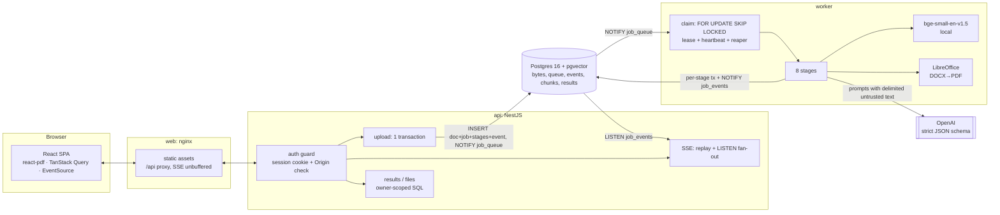
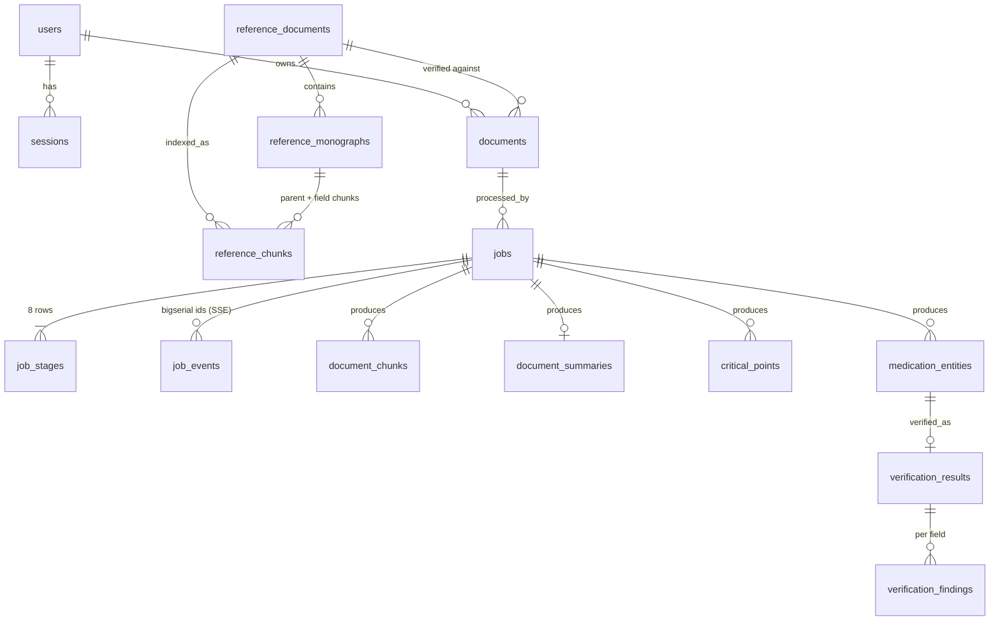

# MediVerify AI

Checks a hospital discharge summary against an institutional formulary digest. It produces:

- a plain-language summary,
- cited critical points,
- a structured medication list,
- and, for each medication, a **Supported / Contradicted / Unsupported** verdict.

Every verdict comes with verbatim, validated evidence from the reference.

> **Fictional data, demo only.** The bundled documents are fictional. Nothing here is clinical advice. The UI shows this
> disclaimer at all times.


| Citation with a verified quote                                                                                                                       | Deep link into the formulary                                                                                        |
| ---------------------------------------------------------------------------------------------------------------------------------------------------- | ------------------------------------------------------------------------------------------------------------------- |
|  |  |

Screenshots are from fixture mode (see the banner); [`scripts/dev/screenshots.ts`](scripts/dev/screenshots.ts)
recaptures them from a running stack.

---

## Quick start (≈ 5–10 min, most of it the first image build)

Prerequisites: Docker Desktop (Compose v2+), about 6 GB free disk space, and ports 8088 and 55432 free.

```bash
cp .env.example .env
```

1. Edit `.env` and pick a mode:
   - **Real inference:** set `OPENAI_API_KEY=` (and optionally `OPENAI_MODEL`).
   - **Fixture mode, no key needed:** set `LLM_PROVIDER=fixture`. It covers only the bundled sample document (see
     [Fixture mode](#llm-modes-real-vs-fixture)).
2. Start the stack:

```bash
docker compose up --build
```

3. Open **http://localhost:8088** and sign in:

| User                               | Email                         | Password          |
| ---------------------------------- | ----------------------------- | ----------------- |
| Reviewer                           | `reviewer@mediverify.test`    | `Reviewer#2026`   |
| Second user (for isolation checks) | `second.user@mediverify.test` | `SecondUser#2026` |

4. Upload `resources/primary_document_medical.pdf` against **MBMC Formulary Digest v8.2**. With a real key you can
   also upload the DOCX rendition `fixtures/sample_discharge.docx`. In fixture mode the DOCX fails with
   `FIXTURE_NOT_FOUND`, because fixtures exist only for the PDF's exact bytes.
5. Watch the stages stream in, then open the citations.

Compose starts these services:

| Service   | What it does                                                                                       |
| --------- | -------------------------------------------------------------------------------------------------- |
| `db`      | Postgres 16 + pgvector. Host port 55432.                                                           |
| `migrate` | One-shot: applies versioned migrations, then the idempotent seed (users + reference registration). |
| `api`     | NestJS.                                                                                            |
| `worker`  | Pipeline runner. Includes LibreOffice and the embedding model baked into the image.                |
| `web`     | nginx serving the SPA and proxying `/api`.                                                         |

The worker indexes the reference once at startup and loads the embedding model before it claims jobs.

### Local development (without containers for the apps)

```bash
pnpm install                       # Node 24, pnpm 10
docker compose up -d db            # Postgres only
pnpm db:migrate && pnpm db:seed    # defaults to localhost:55432; set DATABASE_URL in .env to override
pnpm dev:api                       # :3001 (run from the repo root; the script runs it from apps/api)
pnpm dev:worker
pnpm dev:web                       # :5173, proxies /api → :3001
```

**Environment.** Every setting has a default, so nothing _requires_ a `.env`. Compose reads `.env` automatically, and
the host-side commands (`db:migrate`, `db:seed`, `dev:api`, `dev:worker`, `eval`, `eval:live`) load it if it exists.
Without a `.env`, `LLM_PROVIDER` defaults to `openai` with no key: jobs then fail with `MODEL_NOT_CONFIGURED`. For a
key-less demo use `LLM_PROVIDER=fixture`. `pnpm eval` always uses fixtures; `pnpm eval:live` refuses to start
without `OPENAI_API_KEY`.

**Getting an OpenAI key:** sign in at platform.openai.com, add API credit under _Settings → Billing_ (separate from a
ChatGPT subscription; consider a monthly usage limit), then _API keys → Create new secret key_. Put it in `.env` as
`OPENAI_API_KEY=` and never commit it (`.env` is git-ignored and the pre-commit secret guard blocks keys).

### Configuration

All settings are environment variables with safe defaults; [.env.example](.env.example) lists them with comments.

| Setting                                            | Default                       | Purpose                                                                                           |
| -------------------------------------------------- | ----------------------------- | ------------------------------------------------------------------------------------------------- |
| `LLM_PROVIDER` / `OPENAI_API_KEY` / `OPENAI_MODEL` | `openai` / – / `gpt-5.4-mini` | Model provider (`fixture` for the key-less demo)                                                  |
| `LLM_TIMEOUT_MS` / `LLM_MAX_RETRIES`               | `90000` / `3`                 | Per-call timeout; retries for 429 rate limits, 5xx and network errors                             |
| `ALLOW_SIGNUP`                                     | `true`                        | Set `false` for a hosted demo on a paid key; seed users still sign in                             |
| `DAILY_JOB_LIMIT`                                  | `20`                          | Pipeline runs (uploads + retries) per user per rolling 24 h; `0` = unlimited. Duplicates are free |
| `COOKIE_SECURE`                                    | `false`                       | Set `true` behind HTTPS                                                                           |
| `DUPLICATE_WINDOW_SECONDS`                         | `300`                         | Duplicate-upload window; `0` disables                                                             |
| `RETRIEVAL_TOP_K` / `RETRIEVAL_MIN_SCORE`          | `6` / `0.35`                  | Passages retrieved per medication and the relevance floor (below it → `incomplete`)               |
| `VERIFY_CONCURRENCY`                               | `3`                           | Medications verified in parallel per job                                                          |
| `WORKER_CONCURRENCY`                               | `1`                           | Jobs per worker container; scale out with `docker compose up --scale worker=N`                    |
| `STAGE_TIMEOUT_MS` / `JOB_MAX_ATTEMPTS`            | `180000` / `3`                | Per-stage limit; attempts before a job is marked failed                                           |

---

## What it does: pipeline

Uploading returns `202 {documentId, jobId, duplicate}` immediately. A separate worker process then runs these stages:

| Stage                  | What happens                                                                                                                                                                                                                            |
| ---------------------- | --------------------------------------------------------------------------------------------------------------------------------------------------------------------------------------------------------------------------------------- |
| `parsed`               | pdf.js text with positions and fonts → lines → headings, labeled paragraphs and **reconstructed tables**. DOCX is converted to PDF with headless LibreOffice first, so both formats share one parser, real page numbers and one viewer. |
| `chunked`              | Primary document → paragraph and table-row chunks. Ensures the reference is indexed; an existing index is reused, and the event says so.                                                                                                |
| `embedded`             | Local `bge-small-en-v1.5` (384-d) embeddings into pgvector.                                                                                                                                                                             |
| `summarized`           | A 120–200-word summary from the primary document only. A faithfulness guard requires every number and proper noun to appear in the source.                                                                                              |
| `key_points_extracted` | Critical points by category. Every point needs a page and a quote that validates against the document. Internal discrepancies, such as the two-week vs 8-week psychiatry follow-up, are kept and cite both quotes.                      |
| `entities_extracted`   | Medications with dose, unit, route, frequency, timing, duration, indication, new-start flag and source page/quote. Values from table cells win over model output. Missing or ambiguous values are `null` plus a flag, never guessed.    |
| `verified`             | Identity gate → targeted retrieval → deterministic checks + LLM verifier → evidence-validated merge (details below).                                                                                                                    |
| `done`                 |                                                                                                                                                                                                                                         |

Each stage records its status (`pending → running → completed | failed | skipped`), timestamps, duration and a
sanitized error. Progress is pushed over SSE and survives a page refresh.

### Expected results on the bundled sample

These are the golden cases from `fixtures/golden.json`, which is used **only in tests**:

| Medication                                 | Status                                     | Why                                                                                                                                                                                                                                                             |
| ------------------------------------------ | ------------------------------------------ | --------------------------------------------------------------------------------------------------------------------------------------------------------------------------------------------------------------------------------------------------------------- |
| Velantine 10 mg PO daily                   | Supported                                  | Matches the standard dose and frequency.                                                                                                                                                                                                                        |
| Cordizem-XR 100 mg PO daily                | **Contradicted: dose** (medium confidence) | A new start (newly diagnosed AF) above the 50 mg standard. The monograph requires +25 mg steps at ≥ 2-week intervals, which can't reach 100 mg by discharge day 7. The confidence is medium because this is an interpretation, and the UI shows the arithmetic. |
| Pravoxil 20 mg every morning               | **Contradicted: timing**                   | The monograph says to take it at bedtime and _not_ in the morning.                                                                                                                                                                                              |
| Etrazolam 0.5 mg BID × 8 weeks             | **Contradicted: duration**                 | Maximum duration is 4 weeks.                                                                                                                                                                                                                                    |
| Pranixol 10 mg                             | **Unsupported**                            | No monograph in this digest. Cites the reference's "Drugs not in this digest" note. It is **never** matched to Pravoxil; it is shown only as "similar name, not matched".                                                                                       |
| Quintaxin 20 mg before breakfast × 8 weeks | Supported                                  | Dose, timing and the 8-week reassessment all match.                                                                                                                                                                                                             |

---

## Architecture



**Why these choices.**

- **Postgres is the only stateful service.** It holds the queue, events, vectors and file bytes. There is no Redis or
  object store to operate, and queue state and results commit in the same transactions.
- **A separate worker process.** A slow model call can never block HTTP, and the API never awaits the pipeline.
- **Raw parameterized SQL (`pg`) instead of an ORM.** Ownership filters and transaction boundaries are visible in the code.

### Repository layout

```
apps/api         NestJS HTTP API + SSE            apps/worker       job runner
apps/web         React 19 + Vite 7 + Tailwind 4   packages/shared   zod DTOs, enums, error codes
packages/db      pool, tx helper, migrator, repos packages/core     parsing, chunking, rules, LLM/embeddings, verification, pipeline
db/migrations    versioned forward-only SQL        fixtures/         golden expectations (tests only), fixture LLM outputs, DOCX sample
tests/           integration, e2e, helpers         docs/             evaluation.md, implementation-plan.md
```

### Data model



- Results are keyed by `job_id`, so a retry produces a fresh, consistent set.
- Deleting a user cascades to their documents, jobs and results.
- Deleting a reference is `RESTRICT`ed while documents use it.
- Reference monographs store their **deterministically parsed rules** (`rules jsonb`, each with a verbatim quote)
  alongside the chunks.
- At about 100 reference chunks an exact vector scan is fast enough, so there is deliberately no ANN index. Add HNSW
  when the corpus grows.

**Migrations** live in `db/migrations/NNNN_name.sql`. They are forward-only and applied by a small migrator
(`packages/db/src/migrator.ts`) under an advisory lock. Each file is checksummed in `schema_migrations`, so editing an
applied migration fails loudly. The seed (`scripts/seed.ts`) is idempotent.

### Transaction boundaries

| Operation          | Transaction                                                                                                                                                                                                                                                                                                                                                                                                                                                             |
| ------------------ | ----------------------------------------------------------------------------------------------------------------------------------------------------------------------------------------------------------------------------------------------------------------------------------------------------------------------------------------------------------------------------------------------------------------------------------------------------------------------- |
| Upload             | **One** transaction does all of this:<br/>• advisory lock on (owner, sha256)<br/>• duplicate check (same owner + same bytes + same reference within `DUPLICATE_WINDOW_SECONDS`, which returns `200` with the existing job)<br/>• insert the document, including its bytes<br/>• insert the job and its 8 `job_stages` rows<br/>• insert the `job.queued` event<br/>• `NOTIFY`<br/>Any failure rolls back everything; an integration test injects one after the inserts. |
| Claim              | `UPDATE … WHERE id = (SELECT … FOR UPDATE SKIP LOCKED LIMIT 1)`, which sets the lease.                                                                                                                                                                                                                                                                                                                                                                                  |
| Each stage         | A short transaction marks it `running` and writes an event. The **work runs with no transaction open** (model calls can take seconds). A short transaction then deletes and re-inserts the stage's results, marks it `completed`, writes the event and sends `NOTIFY`. Every write transaction first asserts this worker still holds the lease, so a "zombie" worker that lost its lease cannot overwrite results.                                                      |
| Reference indexing | Idempotent per (sha256, embedding model) under an advisory lock. Concurrent jobs wait, then reuse the index.                                                                                                                                                                                                                                                                                                                                                            |

### Failure and retry policy

- **Retryable errors:** network and 5xx errors, rate limits and timeouts. The job is requeued with exponential backoff
  (base 5 s) up to `max_attempts` (3). Completed stages are skipped on resume.
- **Non-retryable errors:** for example `MODEL_NOT_CONFIGURED`, `MODEL_QUOTA_EXCEEDED` (OpenAI 429
  `insufficient_quota`: no credit left, unlike a plain rate limit), `PARSE_FAILED`, `FIXTURE_NOT_FOUND`, refusals and
  schema-invalid output after retries. The stage becomes `failed`, every later stage becomes `skipped`, and the job is
  marked `failed` with a sanitized message. The UI offers **Retry**, which creates a new job.
- **Crashed or hung workers:**
  - A heartbeat extends the lease every 15 s; the lease is 60 s.
  - A reaper requeues expired leases, or fails the job with `WORKER_LOST` once attempts are used up.
  - Each stage has a timeout (180 s).
  - A job can't stay `running` without a live lease.
- **Shutdown:** on SIGTERM the worker finishes the current stage, requeues the job for the remaining stages and stops
  claiming.

### Real-time progress (SSE)

`GET /api/jobs/:id/events` streams events from the persisted `job_events` table:

- **Replay first.** On connect, the API checks ownership, subscribes to the in-process `LISTEN job_events` fan-out
  first, then replays events with `id > Last-Event-ID` (header or `?lastEventId=`), deduplicating by id.
- **Keep-alive.** A heartbeat comment is sent every 15 s.
- **End of job.** A final `event: end` is sent on a terminal status.
- **Client side.** The client loads the snapshot (`GET /api/jobs/:id`, which includes `lastEventId`), then opens
  `EventSource` from that id. A refresh or a dropped connection loses nothing and duplicates nothing. The timeline
  shows a "reconnecting" state.
- **nginx.** It turns proxy buffering off for this route.

---

## RAG and verification design

### Chunking

- **Monograph-aware reference chunking.** A monograph starts at a heading line followed by `Drug class:`. Each
  monograph gets:
  - one **parent chunk** (identity + all fields), and
  - one **field chunk** per label (Indication, Standard adult dose, Maximum dose, Contraindications, Interactions,
    Monitoring, Adverse effects, Prescribing notes), all sharing `monograph_id`.

  Preface, quick-reference summary and the "Drugs not in this digest" coverage note are separate chunk kinds and can
  never be treated as a monograph. Embedding text is prefixed with the drug name, so field chunks keep their identity.

- **Primary document.** Paragraph chunks, plus one chunk per table row with structured cells. A row is never split.

### Verification, per medication

1. **Identity gate (lexical).** The drug name must match a monograph exactly after normalization ("Cordizem XR" =
   "Cordizem-XR"), or through an explicit alias.
   - Vector or fuzzy similarity **never** establishes identity. `pnpm eval` shows why: plain similarity search ranks a
     look-alike first for _every_ absent name tested (Pranixol → Pravoxil at cosine 0.818, overlapping the true
     matches at 0.86–0.89).
   - No match → **Unsupported**, citing the coverage note. Close names are listed as "similar, not matched".
2. **Targeted hybrid retrieval** inside the matched monograph only: `0.7·cosine + 0.3·ts_rank`, top-K = 6, min score
   0.35. Fields used by deterministic rules are always added, so a ranking miss can't hide a constraint.
   Retrieval failure → `incomplete`, never "unsupported".
3. **Deterministic checks.** Rules are parsed from the monograph text at index time, each with its verbatim quote:
   unit, dose vs standard/reduced/max (single and daily), titration (increment and minimum interval), route,
   frequency, required/forbidden timing, max duration and reassessment.
4. **LLM verifier** (strict JSON schema). It sees only the extracted prescription and the retrieved passages, each in a
   delimited block marked as untrusted data. For each field it returns a verdict
   (`consistent | conflict | not_addressed`), the constraint, an explanation, a `passage_id` and a quote.
5. **Merge and evidence validation.**
   - Every quote must appear (whitespace/quote-normalized) in a chunk that belongs to the **matched** monograph. A
     mislabelled passage id is re-anchored to the chunk that actually contains the quote.
   - A deterministic conflict with a validated quote is authoritative.
   - An LLM-only conflict counts only if its quote validates. Otherwise it is dropped and recorded as invalid evidence.
   - Disagreements are kept, along with `decided_by`.
   - **Status:** any conflict → Contradicted; dose consistent and no conflicts → Supported; otherwise Incomplete.

### Critical points ranking

Points are ordered by a fixed category weight, then by severity:

1. Serious side effect to report
2. Administration timing
3. Duration limit
4. Follow-up / lab
5. General safety
6. Document discrepancy

This puts what a patient or reviewer must act on first. The weights are explicit in
`packages/core/src/tasks/critical-points.ts` and are not left to the model's ordering. Formulary corrections never
rewrite primary-document points. They appear only in verification results, which link to the point about the same drug.

### Hallucination and prompt-injection controls

- **Untrusted inputs.** Documents and retrieved passages are wrapped in delimited blocks; a closing tag inside a
  document is neutralized. The system prompt forbids following instructions found inside them.
- **Constrained output.** All model output is constrained by strict JSON Schema (generated from zod) and re-validated.
- **Citations.** Every citation and critical point is quote-validated. Anything that fails is dropped or marked, never
  shown as verified.
- **Summary guard.** Numbers and capitalized terms in the summary must exist in the source; otherwise it gets one retry,
  then is stored with a visible warning.

### Retrieval evaluation strategy

Retrieval is evaluated as three separate questions, because each one fails in a different way. `pnpm eval` measures
all three against the bundled documents and writes a JSON report (CI keeps it as an artifact). Full tables and
failure modes are in [docs/evaluation.md](docs/evaluation.md).

| Question                                 | How it is measured                                                                                                                                                                                                | Result (fixture LLM, real retrieval)                                                                                                                                                              |
| ---------------------------------------- | ----------------------------------------------------------------------------------------------------------------------------------------------------------------------------------------------------------------- | ------------------------------------------------------------------------------------------------------------------------------------------------------------------------------------------------- |
| **Is the right monograph chosen?**       | Identity gate on 5 positives (the prescribed drugs that have monographs) and 7 negatives: Pranixol plus adversarial look-alikes (Velantina, Quintaxol, Etrazepam, Floranex, Sumavastin, "Cordizem" without "-XR") | 5/5 matched, 7/7 correctly not matched                                                                                                                                                            |
| **Would vector search alone be safe?**   | Diagnostic: the same names queried against _all_ chunks without the gate                                                                                                                                          | Every absent name retrieves a look-alike (e.g. Pranixol → Pravoxil, cosine 0.818, overlapping true matches at 0.86–0.89). No threshold separates them, which is why identity is decided lexically |
| **Are the deciding passages retrieved?** | Recall@K of the expected evidence fields (from the golden file) among passages retrieved inside the matched monograph                                                                                             | Recall@3 0.83, **Recall@6 1.00**, so K defaults to 6                                                                                                                                              |

End to end, the same run checks verdict accuracy (6/6), conflict-field precision and recall (100%/100%), that every
citation's quote validates in its chunk (100%), and that distractor monographs never appear in findings (0).
`pnpm eval:live` repeats the run with real OpenAI inference (`gpt-5.4-mini`). The final live run scored the same as
the fixture run, and also kept the document's internal follow-up discrepancy. The 8 live runs exposed three
problems the fixtures could not show, all fixed: a lost discrepancy, a table-quote validation bug, and an indication
false positive. Details are in [docs/evaluation.md](docs/evaluation.md#live-model-runs-2026-11-10-llm--openai-gpt-54-mini-reasoning-effort-low).

### Tracing one document through the logs

Worker and API write pino JSON. Every pipeline line carries `job_id`, `document_id`, `stage`, `event` and
`duration_ms`, so one document can be followed end to end:

```bash
docker compose logs worker api | grep <job_id>
```

| Stage                    | Events to look for                                                                                                                                                                                                                                                                                                                    |
| ------------------------ | ------------------------------------------------------------------------------------------------------------------------------------------------------------------------------------------------------------------------------------------------------------------------------------------------------------------------------------- |
| Ingestion                | `upload.accepted` / `upload.duplicate` (API: document and job ids, size, type), `job.started`, `stage.started` / `stage.completed` with `duration_ms` and a detail line (pages, blocks, table rows, chunks, index reuse)                                                                                                              |
| Extraction               | `llm.call` (task, model, latency, token usage) and `llm.error` (code, retryable, attempt)                                                                                                                                                                                                                                             |
| Retrieval + verification | `verification.result` per medication: identity-gate outcome (`exact` / `alias` / `none`), matched monograph, rejected look-alike names, top passages (chunk id, field, score), passages dropped below the relevance threshold, conflicting fields, which side decided each finding (deterministic rules or the model), invalid quotes |
| Failure                  | `stage.retrying` (transient error, job requeued; includes the attempt) or `stage.failed` (with `error_code`; later stages skipped, job failed), plus `job.lease_lost` / `reaper.recovered` for worker crashes                                                                                                                         |

Logs never contain passwords, tokens, API keys, document text or quotes; only ids, counts, scores and lengths.

### Models

| Purpose    | Model                                                                                                               | Why                                                                                                                  |
| ---------- | ------------------------------------------------------------------------------------------------------------------- | -------------------------------------------------------------------------------------------------------------------- |
| LLM        | OpenAI, default `gpt-5.4-mini` (`OPENAI_MODEL`), Chat Completions with `response_format: json_schema, strict: true` | Schema-guaranteed output, low cost and latency for extraction. The provider sits behind the `LlmProvider` interface. |
| Embeddings | `Xenova/bge-small-en-v1.5` (384-d, quantized, local via transformers.js, baked into the worker image)               | No key, no data leaves the box, deterministic. Strong retrieval for its size.                                        |

### LLM modes: real vs fixture

| `LLM_PROVIDER`     | Behaviour                                                                                                                                                                                                                                                                                                                                                                                                                       |
| ------------------ | ------------------------------------------------------------------------------------------------------------------------------------------------------------------------------------------------------------------------------------------------------------------------------------------------------------------------------------------------------------------------------------------------------------------------------- |
| `openai` (default) | Real inference. Needs `OPENAI_API_KEY`; without it, jobs fail clearly with `MODEL_NOT_CONFIGURED` and the UI shows a banner.                                                                                                                                                                                                                                                                                                    |
| `fixture`          | **Hand-authored** model outputs for the bundled sample only (keyed by the document's sha256). They live in `fixtures/llm/`. Everything else runs for real: parsing, table reconciliation, embeddings, retrieval, deterministic checks, merge and quote validation. Unknown documents fail with `FIXTURE_NOT_FOUND`; nothing is fabricated. The UI shows a **FIXTURE MODE** banner. Used for CI, the E2E test and offline demos. |

---

## API

All routes are under `/api`. Errors use the shape `{ "error": { "code", "message", "details?" } }`.

| Method | Path                              | Notes                                                                                                                       |
| ------ | --------------------------------- | --------------------------------------------------------------------------------------------------------------------------- |
| POST   | `/auth/signup`                    | 201. Password ≥ 8 characters. Rate-limited.                                                                                 |
| POST   | `/auth/login`                     | 200. Sets the `mv_session` cookie (HttpOnly, SameSite=Strict). Rate-limited. Timing equalized for unknown emails.           |
| POST   | `/auth/logout`                    | 204                                                                                                                         |
| GET    | `/auth/me`                        |                                                                                                                             |
| GET    | `/references`                     | Shared and read-only.                                                                                                       |
| GET    | `/references/:id/file`            | The reference PDF (for the deep link).                                                                                      |
| GET    | `/references/:id/chunks/:chunkId` | Citation preview.                                                                                                           |
| POST   | `/documents`                      | multipart `file` + `referenceId`. Returns **202** `{documentId, jobId, duplicate:false}`, or **200** with `duplicate:true`. |
| GET    | `/documents`                      | The caller's documents with their latest job status.                                                                        |
| GET    | `/documents/:id`                  |                                                                                                                             |
| GET    | `/documents/:id/file`             | Inline PDF (the converted PDF for DOCX). `?download=1` returns the original.                                                |
| GET    | `/jobs/:id`                       | Snapshot: stages, timings, errors, `lastEventId`.                                                                           |
| GET    | `/jobs/:id/events`                | SSE (see above).                                                                                                            |
| GET    | `/jobs/:id/results`               | Summary, critical points, medications, verifications with citations.                                                        |
| POST   | `/jobs/:id/retry`                 | 202. Only for failed jobs.                                                                                                  |
| GET    | `/health`, `/config`              | Liveness; LLM mode for the UI banner.                                                                                       |

**API error codes:**

| Code                     | Meaning                                 |
| ------------------------ | --------------------------------------- |
| `VALIDATION_FAILED`      | 400                                     |
| `UNAUTHENTICATED`        | 401                                     |
| `FORBIDDEN_ORIGIN`       | 403 (CSRF)                              |
| `INVALID_CREDENTIALS`    | 401                                     |
| `EMAIL_TAKEN`            | 409                                     |
| `NOT_FOUND`              | 404, including _other users' resources_ |
| `UNSUPPORTED_MEDIA_TYPE` | 415                                     |
| `PAYLOAD_TOO_LARGE`      | 413 (10 MB)                             |
| `REFERENCE_NOT_FOUND`    | 400                                     |
| `JOB_NOT_RETRYABLE`      | 409                                     |
| `RATE_LIMITED`           | 429                                     |
| `INTERNAL`               | 500 (sanitized)                         |

**Pipeline error codes** (shown on stages and jobs):

- Parsing and indexing: `PARSE_FAILED`, `UNSUPPORTED_DOCUMENT`, `CONVERSION_FAILED`, `REFERENCE_INDEX_FAILED`,
  `EMBEDDING_FAILED`.
- Model: `MODEL_UNAVAILABLE`, `MODEL_NOT_CONFIGURED`, `MODEL_QUOTA_EXCEEDED`, `MODEL_REFUSED`, `MODEL_OUTPUT_INVALID`,
  `MODEL_OUTPUT_TRUNCATED`, `FIXTURE_NOT_FOUND`.
- Runtime: `STAGE_TIMEOUT`, `WORKER_LOST`, `INTERNAL`.

---

## Security and privacy

- **Authorization.** Every user-owned query includes `owner_id = $user` in SQL: documents, file download, jobs, SSE,
  results and retry. Another user's resource returns **404**, not 403. Integration tests check each route, including
  SSE, as a second user. References are shared read-only.
- **Sessions.**
  - Passwords are hashed with argon2id.
  - The session token is 32 random bytes; only its sha256 is stored.
  - Cookie: HttpOnly, SameSite=Strict; `Secure` is configurable for TLS deployments.
  - Mutating requests must carry an allowed `Origin`.
  - Web and API share an origin through the nginx/Vite proxy, so there is no CORS.
- **Spending and abuse limits.** Sign-up can be switched off (`ALLOW_SIGNUP=false`); each user gets a rolling 24 h
  budget of pipeline runs (`DAILY_JOB_LIMIT`, checked inside the job-creating transaction under a per-user lock),
  and login/sign-up are rate-limited per IP. A hosted demo on a paid model key can't be drained by one account.
- **Uploads.** Checked server-side for extension, magic bytes (`%PDF-`, or a DOCX zip containing `word/document.xml`)
  and size. Files are stored as `bytea` and never written to a public path. DOCX conversion runs LibreOffice with an
  isolated, throwaway profile and a timeout.
- **No published source.** Production web images ship no source maps; the PDF viewer (react-pdf + pdf.js) is a
  separate chunk loaded only when a document opens.
- **Dependencies.** CI fails on high/critical advisories in production dependencies (`pnpm audit --prod`).
- **Headers.** nginx sets CSP, `X-Frame-Options: DENY`, `X-Content-Type-Options` and `Referrer-Policy`; the API also
  sets the last two.
- **Secrets** come only from the environment. `.env` is git-ignored. A pre-commit secret guard and gitleaks run in CI.
  The API key never reaches the browser bundle.
- **Logs** are pino JSON with `job_id`, `document_id`, `stage`, `event` and `duration_ms`. They **never** contain
  passwords, tokens, cookies, API keys, raw document text or patient quotes; only lengths, hashes and ids.

---

## Testing and quality

```bash
pnpm test:unit          # 44 tests: parsing/table reconstruction (PDF + LibreOffice-rendered DOCX), monograph chunking & rules,
                        #           identity gate, quote validation, deterministic checks, merge controls, strict schemas,
                        #           injection, error classification, bounded concurrency, dependency pins, and the web
                        #           app's live-progress reducer and upload validation
pnpm test:integration   # 42 tests vs real Postgres (needs `docker compose up -d db`; creates `mediverify_test`)
pnpm test:coverage      # both, with v8 coverage and thresholds (CI publishes the summary and HTML report)
pnpm test:e2e           # Playwright (desktop + Pixel 7) vs the running Compose stack in fixture mode
pnpm eval               # retrieval + classification evaluation → numbers in docs/evaluation.md
pnpm eval:live          # same with real OpenAI (needs OPENAI_API_KEY)
pnpm run ci             # format:check + lint + typecheck + unit + integration (mirrors GitHub Actions)
                        # (`pnpm ci` without `run` is a built-in pnpm command, not this script)
```

The integration tests break down as follows:

- **Golden pipeline (21):** all 6 statuses, the conflicting field, the matched monograph and page, citation integrity,
  no distractor findings, and discrepancy preservation. DOCX parity (identical table cells from the
  LibreOffice-converted DOCX) is covered by the unit tests.
- **API (13):** auth, cookie flags and argon2, CSRF, 401s on every route, 202 atomic upload, validation, **transaction
  rollback** via an injected fault, duplicates, **IDOR across every route including SSE**, and SSE replay, resume and
  live streaming.
- **Worker reliability (6):** non-retryable failure, retry then fail, idempotent resume, `SKIP LOCKED` exclusivity,
  reaper, and zombie-lease protection.
- **Deployment limits (2):** sign-up disabled, per-user daily run budget (duplicates free, retries counted).

Coverage (unit + integration, 2026-11-10): 57.6% statements, 77.5% branches, 72.4% functions. Server-side code is
well covered; React components are covered only by the Playwright smoke test, which is the main gap.

**Tooling.**

- TypeScript strict (`noUncheckedIndexedAccess`, `exactOptionalPropertyTypes`).
- ESLint flat config, type-aware, with `no-floating-promises`, import order, react-hooks and jsx-a11y.
- Prettier.
- Husky hooks:
  - `pre-commit`: lint-staged + secret guard.
  - `commit-msg`: commitlint (Conventional Commits).
  - `pre-push`: typecheck + unit tests.

  `pnpm install` installs the hooks through `prepare`, but only inside a git repository. If you ran `pnpm install`
  before `git init` (or hooks don't fire), run `pnpm exec husky` once. `git config core.hooksPath` should then print
  `.husky/_`.

**CI/CD** (`.github/workflows/`):

- `ci.yml` runs these jobs:
  - quality
  - test, with a pgvector service and the eval report as an artifact
  - compose build + Playwright E2E
  - security (`pnpm audit` + gitleaks)
  - a manual `eval-live` job gated on the `OPENAI_API_KEY` secret
- `release.yml` builds images on `v*` tags and pushes to GHCR only when the `PUBLISH_IMAGES` variable is enabled.
- Dependabot is configured for npm, Actions and Docker.

> **Status (2026-11-10):** GitHub Actions passes on `main`: quality, unit + integration tests, the Compose build with
> Playwright E2E (desktop + Pixel 7, fixture mode), and the secret scan. Locally: 46 unit, 42 integration and 4
> Playwright tests pass (coverage thresholds enforced). Live OpenAI evaluation ran locally (`pnpm eval:live`, 2026-11-10);
> the manual `eval-live` CI job needs an `OPENAI_API_KEY` repository secret and has not run in CI.

Measured evaluation results, method and failure modes are in **[docs/evaluation.md](docs/evaluation.md)**.

---

## Extra credit

- ✅ **Deep-link citations.** "View in reference document" opens the formulary PDF at the cited page with the exact
  quote highlighted.
- ✅ **Duplicate upload detection.** Same owner + same bytes (sha256 content hash) + same reference within the window
  returns the existing job. The window is `DUPLICATE_WINDOW_SECONDS` (default 300 = 5 minutes; 0 disables it). The
  check runs inside the upload transaction under an advisory lock on (owner, hash), so two simultaneous uploads can't
  both create jobs.

## Trade-offs and known limitations

- **Small live evaluation set.** Live numbers come from one document (8 full runs plus targeted runs). Model output
  varies between runs; one run in eight produced an indication false positive, which is now guarded in code. A larger
  synthetic set is the next step.
- **Cordizem-XR is interpretive.** The titration rule is applied because the document describes a new start. If the
  model can't tell whether it's a new start, confidence drops to low.
- **Indication checks are LLM-only** (semantic). The deterministic checks don't judge indications. A model-only
  indication conflict counts only when the cited text excludes or restricts the use; absence from the list does not count.
- **Parsing limits.** No OCR, so scanned PDFs fail with `PARSE_FAILED`. Rotated tables and tables without a first
  column per row are not handled.
- **Monograph rule parsing** uses patterns fitted to this digest's phrasing. A differently worded formulary would need
  more patterns, or LLM rule extraction validated against quotes.
- **Synonyms.** Brand/generic synonyms require an explicit alias table; none is shipped.
- **Single region, single worker by default.** Scale by adding worker replicas; the claim is `SKIP LOCKED`-safe.
- **Image size.** The worker image is large because of LibreOffice and the baked model.
- **Storage.** File bytes live in Postgres, which is fine at a 10 MB cap. Use object storage at scale.
- **Data lifecycle.** There is no endpoint to delete a document, and no retention job for old documents, job events
  or expired sessions.
- **Rate limiting is per API process** (in-memory). With several API replicas it needs a shared store (Postgres
  or Redis). The daily job limit is already enforced in Postgres.
- **The document list shows the latest 50**, with no pagination.
- **Observability is logs only.** There are no metrics (queue depth, stage latency, token cost) and no tracing.
- **References are loaded by the seed script.** The schema is versioned, but there is no admin API to upload, index or
  select a new formulary version.

## With more time

1. Build a larger synthetic evaluation set (more documents, adversarial look-alikes), and run it live on a schedule.
2. Add a delete endpoint with a retention job, metrics (Prometheus or OpenTelemetry) and a shared rate limiter.
3. Add a reviewer feedback loop: accept or override a finding, with an audit trail.
4. Add OCR fallback and HNSW indexing for larger corpora.
5. Make reference versions diffable, and re-verify on a new version.
